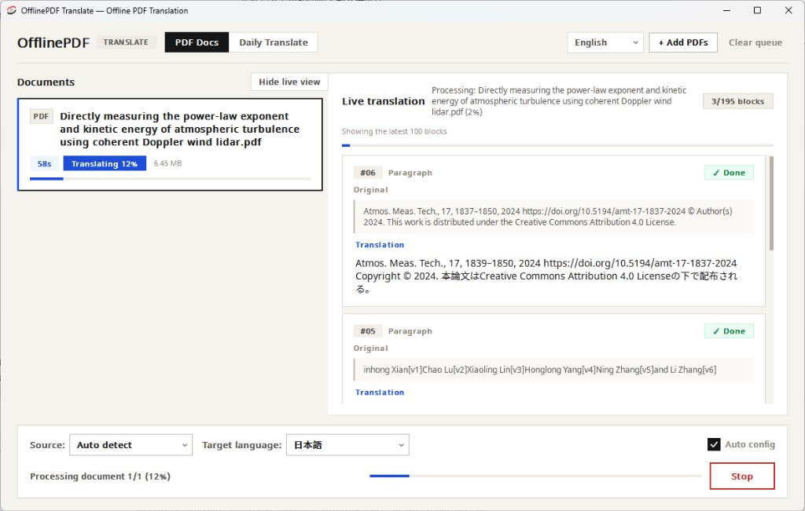
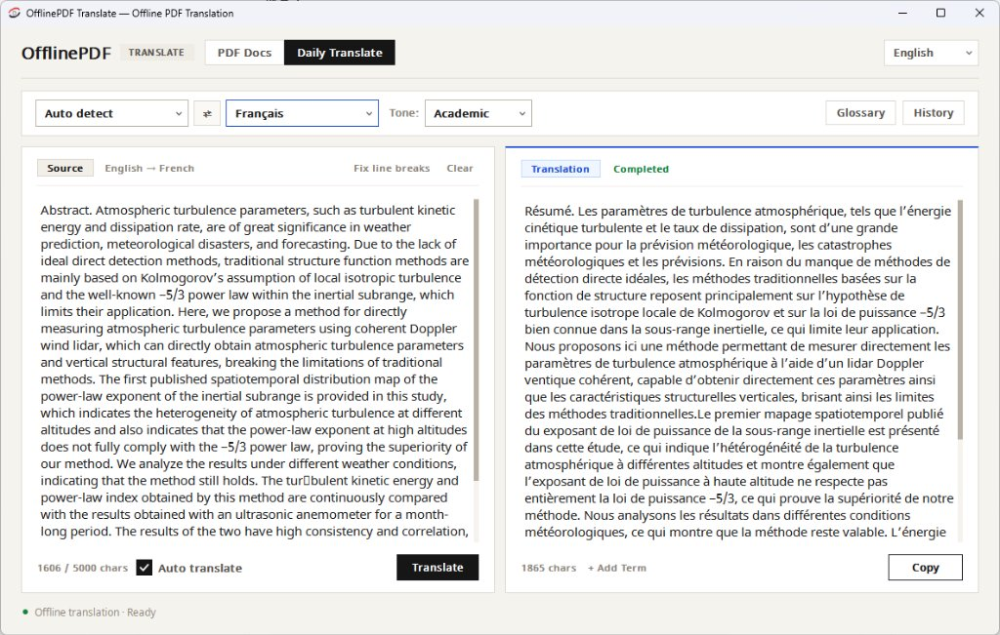
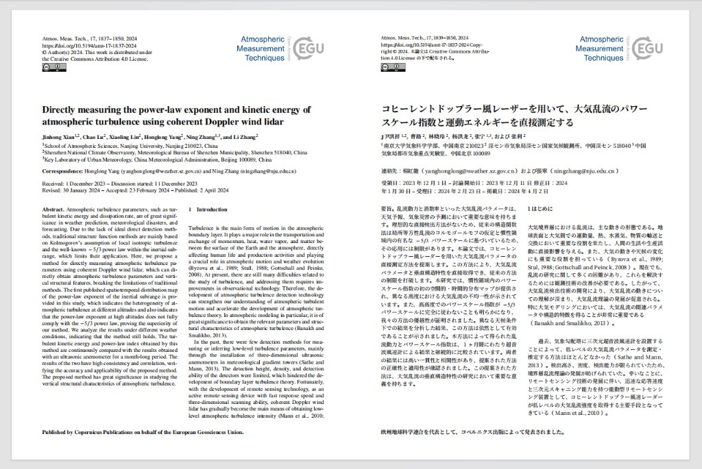
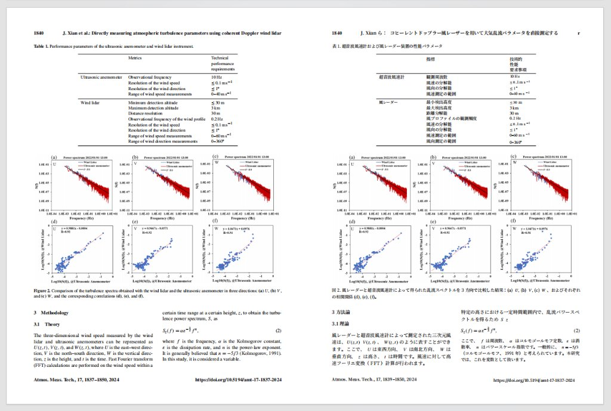

<p align="center">
  
</p>

<h1 align="center">OfflinePDF-Translate</h1>

<p align="center">
  Fully Local Offline Academic PDF Translation Workbench · Bilingual Side-by-Side · Translated Output · Hardware-Adaptive Inference
</p>

<p align="center">
  <a href="#screenshots">Screenshots</a>
  · <a href="#install--use">Install & Use</a>
  · <a href="#data--privacy">Data & Privacy</a>
  · <a href="#system-compatibility">System Compatibility</a>
  · <a href="#faq">FAQ</a>
  · <a href="docs/BUILD.md">Build Guide</a>
</p>

<p align="center">
  
  
  <a href="LICENSE"></a>
</p>

<p align="center">
  English | <a href="docs/README.zh-CN.md">简体中文</a> | <a href="docs/README.ja.md">日本語</a> | <a href="docs/README.ko.md">한국어</a> | <a href="docs/README.ru.md">Русский</a>
</p>

---

OfflinePDF Translate is a project focused on local offline PDF literature translation. After downloading the installer, users can install and launch it directly on an offline computer with no internet connection required, enabling free, unlimited PDF literature and daily translation. The installer can also be saved on a USB flash drive and plugged into any offline computer for immediate installation and use. Powered by Tencent Hunyuan MT2-1.8B, it supports mutual translation across 38 languages and dialects.

The project uses BabelDOC and DocLayout-YOLO for PDF parsing, layout recognition, and bilingual typesetting (text-extractable PDFs only; scanned image PDFs are not supported), and runs local translation inference via llama.cpp with Tencent Hunyuan (Hy-MT2-1.8B). It bundles a standalone Python runtime, inference engine, quantized model, and font/layout assets, supporting batch queues, bilingual and translated-only PDF outputs, document-level process isolation, and automatic hardware scheduling (runs reliably even on CPU-only machines).

## Screenshots

<table>
  <tr>
    <td align="center" width="50%">
      
      <br><sub><b>PDF Workbench &amp; Live Stream</b> — Batch queue with real-time paragraph inspection</sub>
    </td>
    <td align="center" width="50%">
      
      <br><sub><b>Daily Translation</b> — Instant text translation, tone presets &amp; glossary</sub>
    </td>
  </tr>
  <tr>
    <td align="center" width="50%">
      
      <br><sub><b>Bilingual PDF Output</b> — Side-by-side layout preserving titles, affiliations &amp; columns</sub>
    </td>
    <td align="center" width="50%">
      
      <br><sub><b>Tables, Figures &amp; Formulas</b> — High-fidelity preservation of academic typesetting</sub>
    </td>
  </tr>
</table>

## Install & Use

### Windows One-Click Installer

1. Download the latest `OfflinePDF-Translate-Setup.exe` from GitHub Releases.
2. Double-click to install. Because this open-source project does not use a commercial code-signing certificate, if Windows SmartScreen prompts, click **More info → Run anyway** to continue.
3. Launch the application, drag and drop PDF files, choose the target language at the bottom, and click Start.

### Output & Quality Boundaries

- `[name].翻译.pdf` (translated) and `[name].对照.pdf` (bilingual) are generated in the source directory and marked successful only when both PDFs pass validation. If the source directory is not writable, outputs are automatically saved to `Translated PDFs` under the user data directory.
- Successful re-translations atomically replace existing files of the same name via temporary files in the same directory; failed runs preserve the original outputs.
- Missing placeholders, truncated outputs, empty translations, or suspected source-text echoes automatically trigger retries. If issues persist after retries, the program attempts to repair placeholders or falls back to the source text to ensure layout delivery. Therefore, a "Completed" status does not guarantee every paragraph is flawless—important literature should be verified against the live stream and translated text.
- **Text-extractable PDFs only**: Bitmap scans have no built-in OCR engine and will be explicitly rejected with a prompt to run OCR first.
- **Complex script typesetting**: The UI uses bundled fonts and PDF typesetting embeds offline fonts. Right-to-left scripts such as Arabic and certain complex combining characters may currently lay out inaccurately; the UI displays a warning when these target languages are selected.

### Interface Language

On first launch (and during installation), the application automatically detects your OS display language and falls back to English if unsupported. You can switch between **简体中文, English, 日本語, 한국어, Русский** in the top-right corner of the window; changes take effect immediately and are saved automatically. The "Target Language" selector at the bottom independently controls the PDF translation language.

### Daily Translation Workbench

Switch to the **Daily Translation** tab at the top bar for instant offline text translation without interrupting the PDF pipeline (shares the local model cleanly and pauses if a PDF job is actively running):

- **Auto bilingual `中 ⇄ 英` & 38 languages**: Automatically detects Chinese vs. English or translates between any supported language pair, with streaming output (`Ctrl+Enter` or auto-translate).
- **PDF copy cleanup & file drop**: One-click cleanup of hard line breaks and hyphenated words copied from PDFs (preserving code blocks and list formatting), plus drag-and-drop for `.txt`, `.md`, `.srt`, `.vtt`, `.csv`, `.tsv`, and `.log` files (up to 5,000 chars per request).
- **Hy-MT2 style & glossary**: Built-in style presets (`default`, `academic`, `formal`, `casual`, `concise`), hit-only glossary injection, quick term creation from selection, and local translation history.

### Command-Line Interface (CLI)

For batch scripting or headless usage from source/runtime:

```powershell
.\runtime\python\python.exe cli.py translate paper.pdf --lang-in auto --lang-out zh
```

Supports `-o/--output`, `-p/--pages` (e.g. `1-3` or `1,3,5`), `--threads`, `--parallel`, `--ctx-size`, `--gpu-layers` / `--ngl`, `--model`, `--runtime`, and `--no-background`.

---

## Data & Privacy

- **Fully local offline execution**: No accounts, no telemetry, no ads, and no cloud translation API keys required.
- **Loopback network restriction**: Startup checks verify fonts, CMap, tokenizer, ONNX, and GGUF readiness. Python network connections in translation subprocesses are restricted to loopback addresses, and local `llama-server` listens only on `127.0.0.1` (note: this is an application-level policy restriction, not OS-level sandbox isolation).
- **Data storage location**: Caches, task queues, and runtime logs are stored in the user data directory (`%LOCALAPPDATA%\OfflinePDF Translate` on Windows), so the installation directory does not need to be writable. In-place upgrades preserve user data; uninstalling automatically removes the application, user data directory, caches, logs, queues, glossaries, history, and saved interface language settings. Intermediate document files are placed in isolated temporary directories and cleaned up upon completion.

---

## System Compatibility

- **Windows 10/11 (64-bit, x64)**: Officially and fully supported with a single-file installer bundling all runtimes. The installer verifies the minimum OS version during setup.
- **Windows 7/8**: **Not supported** (bundled Python 3.13 and PySide6 6.11 have dropped support for older Windows versions).
- **macOS / Linux**: No official signed installers are provided. Basic platform adaptation and source test compatibility are retained in core code; you must prepare a Python 3.13 environment and a platform-appropriate `llama-server` yourself.

---

## Scheduling & Hardware Policy

- Documents are processed sequentially from the queue, with intra-document concurrency across inference slots calculated from available memory and devices; each document runs in an isolated subprocess.
- Default per-segment inference timeout is 600 seconds (10 minutes) and no-progress timeout is 900 seconds, supporting overnight CPU-only runs on low-power ultrabooks with system sleep-prevention wake locks. On Windows, a Job Object uniformly reclaims typesetting helper subprocesses.
- Thread count, concurrent slots, context window, and GPU offload layers all support auto-detection as well as manual fine-tuning in the UI.

---

## FAQ

### Can I run it without a dedicated GPU (CPU only)?
Yes. The installer bundles full CPU instruction-set backends, automatically matching your CPU and calculating suitable thread counts and context windows. Long documents simply take longer on CPU.

### What if Windows shows "Windows protected your PC" when I run the installer?
This is a standard SmartScreen prompt triggered because an individual open-source project does not have a commercial code-signing certificate. Click **More info → Run anyway** to install normally.

### Why do some PDFs report that they cannot be translated or are detected as scans?
This project relies on embedded extractable text and layout objects in PDFs. Pure image scans lack a text layer and must be converted to dual-layer PDFs with an OCR tool before importing.

### Where are the translated files saved?
By default, they are written directly to the original PDF's directory (`[name].翻译.pdf` and `[name].对照.pdf`). If that directory is write-protected, they are automatically saved to `%LOCALAPPDATA%\OfflinePDF Translate\Translated PDFs`.

### How do I troubleshoot startup failures or translation errors?
Check the runtime logs and `llama-server.log` under `%LOCALAPPDATA%\OfflinePDF Translate\logs`. When filing an issue, please attach sanitized error logs and your system configuration, and never upload private source papers.

---

## Building & Development

The source repository does not include the bundled Python runtime, `llama.cpp` binaries, GGUF model, or most font/ONNX assets. For local build and packaging instructions, see the [Build Guide (docs/BUILD.md)](docs/BUILD.md).

The six direct dependencies (`babeldoc`, `pymupdf`, `psutil`, `bitstring`, `tibs`, `PySide6-Essentials`) pull in several transitive dependencies (such as OpenCV for layout processing or the `openai` SDK referenced internally by BabelDOC); their presence does not mean cloud translation or OCR is enabled.

---

## Acknowledgments & Related Projects

OfflinePDF Translate is built upon and inspired by these open-source projects and models:

- [BabelDOC](https://github.com/funstory-ai/BabelDOC) (AGPL-3.0): Core PDF parsing, layout reconstruction, formula protection, and bilingual typesetting engine.
- [PDFMathTranslate / pdf2zh](https://github.com/PDFMathTranslate/PDFMathTranslate): Pioneering project and workflow inspiration for bilingual academic PDF translation.
- [llama.cpp](https://github.com/ggml-org/llama.cpp) (MIT): Lightweight, high-performance local GGUF inference runtime.
- [Tencent-Hunyuan/Hy-MT2](https://github.com/Tencent-Hunyuan/Hy-MT2) / [Hy-MT2-1.8B](https://huggingface.co/tencent/Hy-MT2-1.8B-GGUF): On-device multilingual translation capability and official dual-track instruction, glossary intervention, and style-control prompt specifications.
- [DocLayout-YOLO](https://github.com/opendatalab/DocLayout-YOLO) (AGPL-3.0): Academic document layout detection model.
- [KFERMercer/RiipL](https://github.com/KFERMercer/RiipL): Desktop translator built on Qt 6 and Hy-MT2; inspired the daily translation module's glossary management, style presets, and clipboard workflow.
- [ziniee/local-translate](https://github.com/ziniee/local-translate): Local desktop translator with embedded llama.cpp; inspired verbatim code-block pass-through, sliding-window chunking, and hit-only glossary injection.
- [CopyTranslator](https://github.com/CopyTranslator/CopyTranslator) & [msc306/AI-Translate](https://github.com/msc306/AI-Translate): Inspired high-frequency daily UX patterns such as PDF copy line-break cleanup, clipboard monitoring, streaming speed display, and auto-copy.
- [PySide6 (Qt for Python)](https://doc.qt.io/qtforpython-6/) & [PyMuPDF](https://github.com/pymupdf/PyMuPDF): Desktop UI framework and low-level PDF processing support.

## Contributing & License

- Issues & feature requests: [GitHub Issues](../../issues)
- Contributing guide: [CONTRIBUTING.md](CONTRIBUTING.md) · Code of Conduct: [CODE_OF_CONDUCT.md](CODE_OF_CONDUCT.md)
- Security policy: [SECURITY.md](SECURITY.md) · Third-party notices: [THIRD_PARTY_NOTICES.md](THIRD_PARTY_NOTICES.md)

The source code of this project is released under [GNU AGPL-3.0](LICENSE); third-party components, fonts, and model weights retain their respective original licenses.
