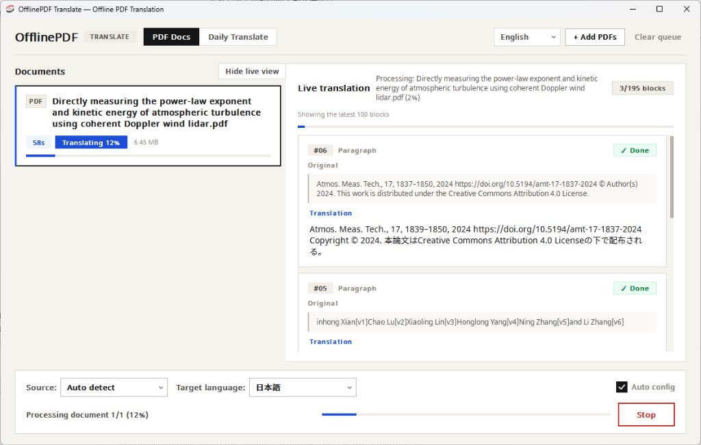
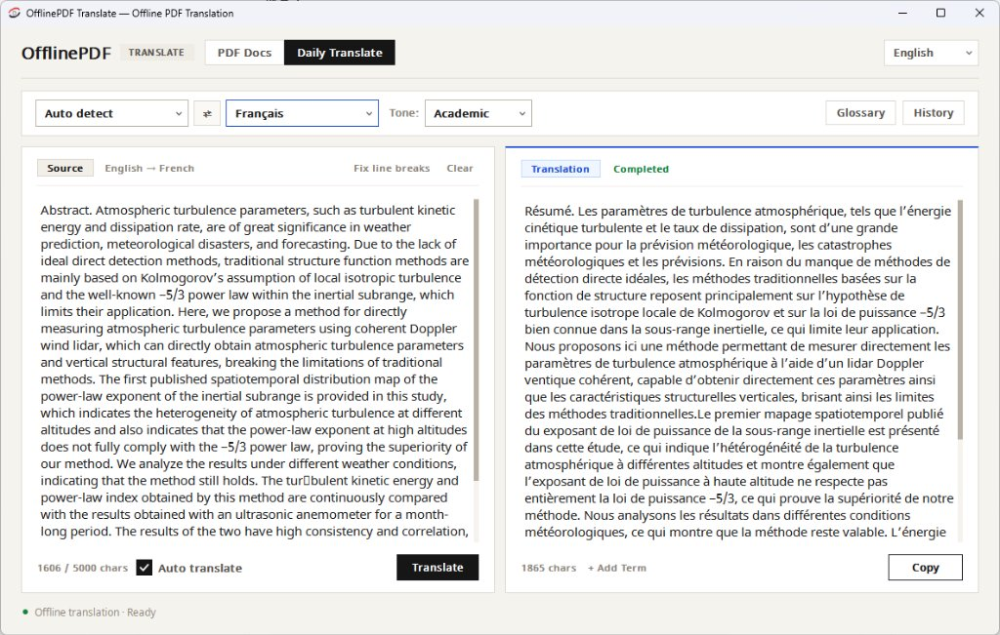
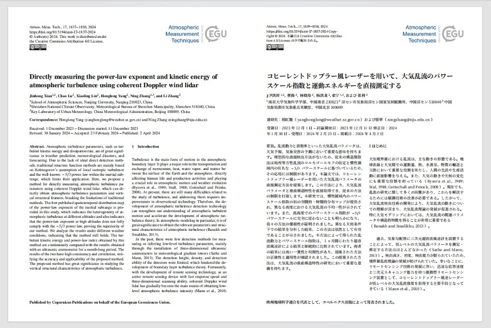
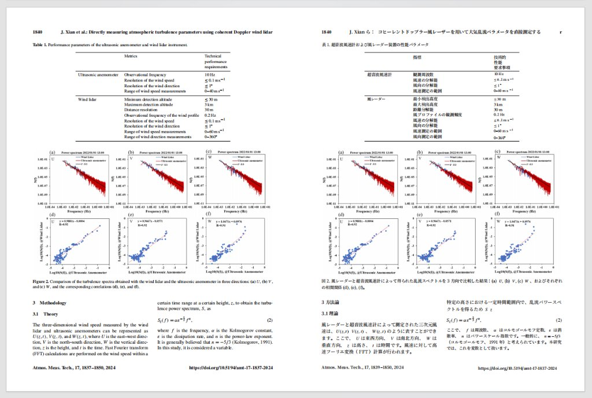

<p align="center">
  
</p>

<h1 align="center">OfflinePDF-Translate</h1>

<p align="center">
  纯本地离线学术PDF翻译工作台 · 双语对照 · 译文输出 · 硬件自适应推理
</p>

<p align="center">
  <a href="#界面与效果演示">界面与效果演示</a>
  · <a href="#安装与使用">安装与使用</a>
  · <a href="#数据与隐私">数据与隐私</a>
  · <a href="#系统兼容性">系统兼容性</a>
  · <a href="#常见问题">常见问题</a>
  · <a href="BUILD.md">构建说明</a>
</p>

<p align="center">
  
  
  <a href="../LICENSE"></a>
</p>

<p align="center">
  <a href="../README.md">English</a> | 简体中文 | <a href="README.ja.md">日本語</a> | <a href="README.ko.md">한국어</a> | <a href="README.ru.md">Русский</a>
</p>

---

OfflinePDF Translate是一个专注于本地离线翻译PDF文献的项目。用户下载安装包后可直接在离线计算机上安装并启动运行，无需任何联网操作，即可免费、无限次地完成PDF文献及日常翻译工作；将安装包保存到U盘中，也可随时插入离线计算机立刻安装运行。项目基于腾讯混元MT2-1.8B大模型，支持38种语言及方言互译。

项目基于BabelDOC与DocLayout-YOLO进行PDF解析、版面识别和双语排版（仅支持含可提取文本的PDF，不支持扫描类型的PDF），并通过llama.cpp与腾讯混元大模型（Hy-MT2-1.8B）完成本地推理翻译；软件内置独立Python运行时、推理引擎、量化模型与字体/版面资产，支持批量队列、双语对照与纯译文PDF输出、文档级进程隔离及自动硬件调度（纯CPU亦可稳定运行）。

## 界面与效果演示

<table>
  <tr>
    <td align="center" width="50%">
      
      <br><sub><b>PDF 文献翻译与实时流</b> — 批量队列与逐段原文/译文即时核查</sub>
    </td>
    <td align="center" width="50%">
      
      <br><sub><b>日常翻译工作台</b> — 即时文本互译、风格预设与术语表干预</sub>
    </td>
  </tr>
  <tr>
    <td align="center" width="50%">
      
      <br><sub><b>双语对照 PDF 输出</b> — 完整保留标题、作者机构与双栏学术版式</sub>
    </td>
    <td align="center" width="50%">
      
      <br><sub><b>表格、插图与公式保护</b> — 高保真还原学术图表与数学公式排版</sub>
    </td>
  </tr>
</table>

## 安装与使用

### Windows一键安装

1. 前往 [GitHub Releases](../../releases) 或国内镜像 [GitCode Releases](https://gitcode.com/SRT117/OfflinePDF-Translate/releases) 下载最新版本的 `OfflinePDF-Translate-Setup.exe`（若发布分卷版本，请将 `.exe` 与全部 `.bin` 分卷下载到同一文件夹）。
2. 双击安装。由于开源项目未购买商业代码签名证书，若遇到Windows SmartScreen拦截提示，点击**“更多信息” → “仍要运行”**即可继续。
3. 启动程序，拖入PDF文件，在底部选择目标语言后点击开始即可。


### 输出与质量边界

- 源目录会生成 `[原名].翻译.pdf` 和 `[原名].对照.pdf`，仅当两份PDF均校验有效时才标记成功；若源目录不可写，则自动保存至用户数据目录下的 `Translated PDFs`。
- 重新翻译成功时通过同目录临时文件原子替换同名输出，失败时保留原有输出。
- 占位符缺失、输出截断、空译文或疑似原文回传会自动触发重试；若重试后仍有问题，程序会尽量修复占位符或保留原文以确保排版交付，因此“完成”状态不代表每段译文都完美无误，重要文献建议对照实时流与译文核对。
- **仅支持含可提取文本的PDF**：位图扫描件没有内置OCR引擎，会被明确拦截并提示先做OCR。
- **复杂文字排版**：界面使用随包字体，PDF排版嵌入离线字体；阿拉伯文等从右向左文字及部分复杂组合字符当前排版可能不准确，选择这些目标语言时界面会给出提示。

### 界面语言 / Interface language

在窗口右上角可切换**简体中文、English、日本語、한국어、Русский**，切换立即生效并自动保存。窗口底部的“目标语言”独立控制PDF的译文语言。

### 日常翻译工作台

点击顶部导航栏的**日常翻译**，即可使用零干扰的本地即时文本互译（与PDF队列自动互斥，不争抢本地推理资源）：

- **自动互译与38种语言**：支持 `中 ⇄ 英` 自动识别互译及全部38种受支持语种/方言，支持流式输出（`Ctrl+Enter` 快捷触发或输入防抖自动翻译）。
- **PDF断行整理与文本拖入**：一键合并从PDF复制文本中的断词连字符与硬换行（保留代码块与列表结构），并支持拖入 `.txt`、`.md`、`.srt`、`.vtt`、`.csv`、`.tsv`、`.log` 文件（单次上限5000字）。
- **Hy-MT2风格与术语表**：内置风格预设（默认、学术、正式、口语、精简）、按命中词条注入术语表、划词快速设为术语及本地历史记录。

### 命令行工具（CLI）

在源码或随包运行时环境下可通过命令行调用：

```powershell
.\runtime\python\python.exe cli.py translate paper.pdf --lang-in auto --lang-out zh
```

支持 `-o/--output`、`-p/--pages`（如 `1-3` 或 `1,3,5`）、`--threads`、`--parallel`、`--ctx-size`、`--gpu-layers` / `--ngl`、`--model`、`--runtime` 与 `--no-background`。

---

## 数据与隐私

- **纯本地离线执行**：无账号体系、无遥测、无广告，不依赖任何云端翻译API Key。
- **回环网络限制**：运行前会对字体、CMap、分词器、ONNX与GGUF进行就绪检查；翻译子进程中的Python网络连接被限制在回环地址，本地 `llama-server` 仅监听 `127.0.0.1`（注：此为应用层策略限制，并非操作系统级沙盒隔离）。
- **数据存储位置**：缓存、任务队列与运行日志保存于用户数据目录（Windows上为 `%LOCALAPPDATA%\OfflinePDF Translate`），不要求安装目录可写；覆盖升级时会保留现有用户数据，卸载程序会自动清理程序目录、用户数据目录、缓存、日志、队列、术语表、历史记录及界面语言注册表设置，不留残留。文档中间文件放入独立临时目录并在结束时清理。

---

## 系统兼容性

- **Windows 10/11（64位，x64）**：官方完整支持，提供内置全部运行时的单文件安装包，安装程序会在安装阶段校验最低系统版本。
- **Windows 7/8**：**不支持**（内置的Python 3.13与PySide6 6.11均已停止支持旧版Windows）。
- **macOS / Linux**：不提供官方签名安装包，仅在核心代码中保留了基础平台适配与源码测试兼容，需自行准备Python 3.13环境及对应平台的 `llama-server` 运行。

---

## 调度与硬件策略

- 文档按队列依次处理，单篇文档内部按可用内存与设备推算的推理槽位并发，每篇文档运行在独立隔离进程中。
- 默认单段推理超时600秒（10分钟），无进度超时900秒，支持低功耗轻薄本纯CPU通宵挂机与系统防睡眠唤醒锁定；Windows下通过Job Object统一回收文档的排版辅助子进程。
- 线程数、并发槽位、上下文窗口与GPU卸载层数均支持自动探测及界面手动微调。

---

## 常见问题

### 没有独立显卡，只有CPU能不能用？
可以。安装包默认内置全套CPU指令集后端，会自动匹配本机CPU并推算合适的线程数与上下文窗口，只是长文献翻译耗时相对更长。

### 双击安装包时Windows弹出“已保护你的电脑”怎么办？
这是因为个人开源项目未购买商业代码签名证书触发的SmartScreen常规提示，点击弹窗里的**“更多信息” → “仍要运行”**即可正常安装。

### 为什么有些PDF提示无法翻译或识别为扫描件？
本项目依赖PDF内嵌的可提取文本与版面对象。纯图片扫描件没有文字层，需先使用OCR工具转为双层PDF后再导入翻译。

### 翻译后的文件保存在哪里？
默认直接输出到原PDF所在目录（`[原名].翻译.pdf` 与 `[原名].对照.pdf`）；若原目录受权限保护不可写，则自动存入 `%LOCALAPPDATA%\OfflinePDF Translate\Translated PDFs`。

### 遇到启动失败或翻译报错如何排查？
可以查看 `%LOCALAPPDATA%\OfflinePDF Translate\logs` 下的运行日志与 `llama-server.log`。提交Issue时请附上脱敏后的错误日志与系统配置，切勿上传含隐私内容的论文原文。

---

## 构建安装包与开发

源码仓库不包含内置Python运行时、`llama.cpp` 二进制文件、GGUF模型及大部分字体/ONNX资产，本地构建与打包步骤请阅读[构建说明（docs/BUILD.md）](BUILD.md)。

六项直接依赖（`babeldoc`、`pymupdf`、`psutil`、`bitstring`、`tibs`、`PySide6-Essentials`）会引入若干传递依赖（例如用于版面处理的OpenCV或BabelDOC内部引用的 `openai` SDK），这些依赖的存在不代表程序启用了云端翻译或OCR。

---

## 致谢与相关项目

OfflinePDF Translate的实现基于并受益于以下优秀的开源项目与模型：

- [BabelDOC](https://github.com/funstory-ai/BabelDOC)（AGPL-3.0）：核心PDF解析、版面还原、公式保护与双语排版引擎。
- [PDFMathTranslate / pdf2zh](https://github.com/PDFMathTranslate/PDFMathTranslate)：学术文献双语对照翻译工作流的先驱项目与思路启发。
- [llama.cpp](https://github.com/ggml-org/llama.cpp)（MIT）：轻量高性能的本地GGUF模型推理运行时。
- [Tencent-Hunyuan/Hy-MT2](https://github.com/Tencent-Hunyuan/Hy-MT2) / [Hy-MT2-1.8B](https://huggingface.co/tencent/Hy-MT2-1.8B-GGUF)：提供端侧多语种翻译能力及官方双轨指令、术语干预与风格控制模板规范。
- [DocLayout-YOLO](https://github.com/opendatalab/DocLayout-YOLO)（AGPL-3.0）：论文版面布局检测模型。
- [KFERMercer/RiipL](https://github.com/KFERMercer/RiipL)：基于Qt 6与Hy-MT2的桌面翻译器，日常翻译模块的术语表管理、风格预设与剪贴板工作流借鉴了该项目的交互思路。
- [ziniee/local-translate](https://github.com/ziniee/local-translate)：内嵌llama.cpp的本地桌面翻译器，借鉴了代码块原样透传、长文滑窗分块与按命中词条注入术语表的实现思路。
- [CopyTranslator](https://github.com/CopyTranslator/CopyTranslator) & [msc306/AI-Translate](https://github.com/msc306/AI-Translate)：借鉴了PDF复制断行整理、监听剪贴板、流式输出速率展示与自动复制等日常高频交互设计。
- [PySide6 (Qt for Python)](https://doc.qt.io/qtforpython-6/)与[PyMuPDF](https://github.com/pymupdf/PyMuPDF)：桌面界面框架与底层PDF处理支撑。

## 参与与许可

- 问题反馈与功能建议：[GitHub Issues](../../../issues)
- 贡献指南：[CONTRIBUTING.md](../CONTRIBUTING.md) · 社区准则：[CODE_OF_CONDUCT.md](../CODE_OF_CONDUCT.md)
- 安全政策：[SECURITY.md](../SECURITY.md) · 第三方声明：[THIRD_PARTY_NOTICES.md](../THIRD_PARTY_NOTICES.md)

本项目源码以[GNU AGPL-3.0](../LICENSE)发布；第三方组件、字体和模型权重各自保留其原始许可。
